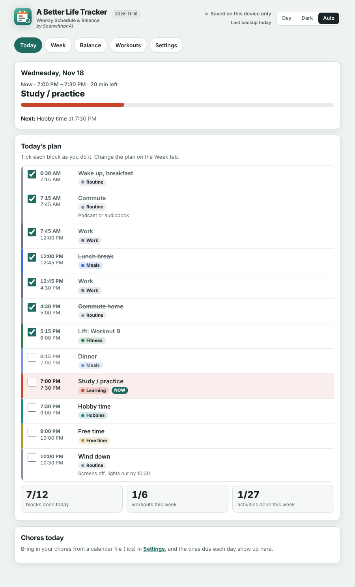
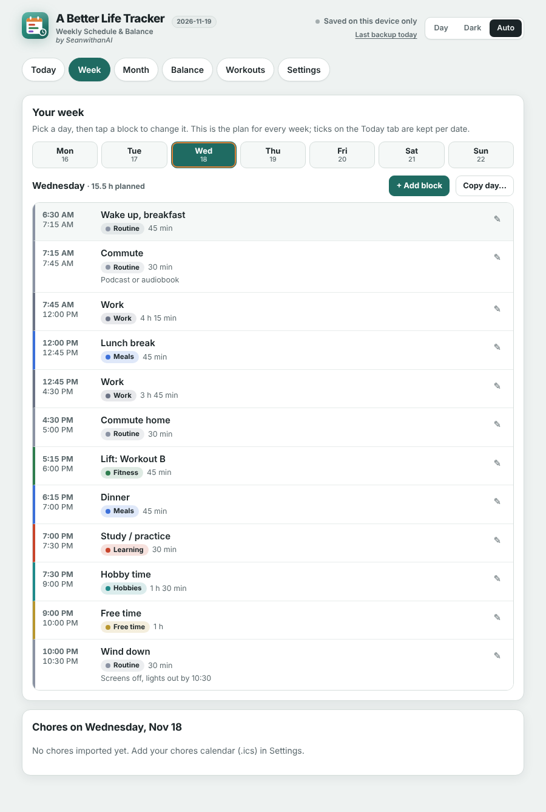
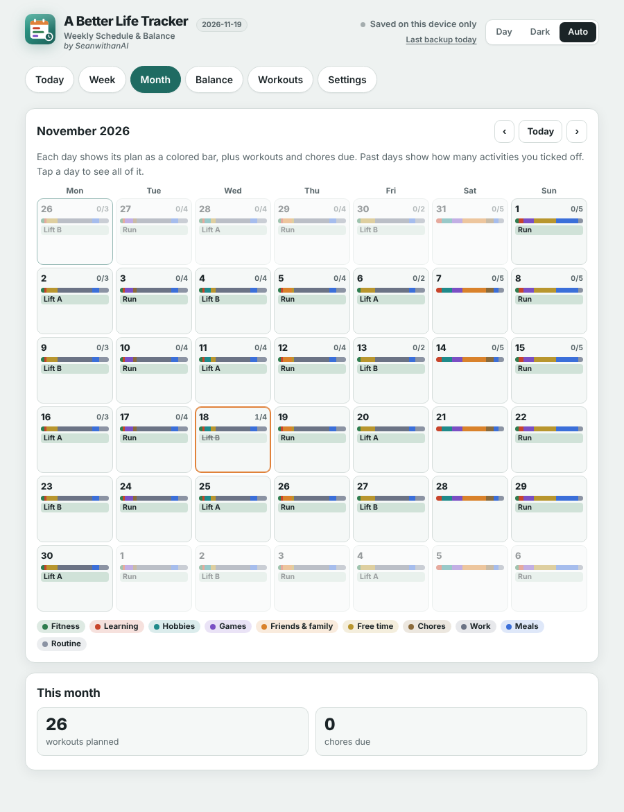
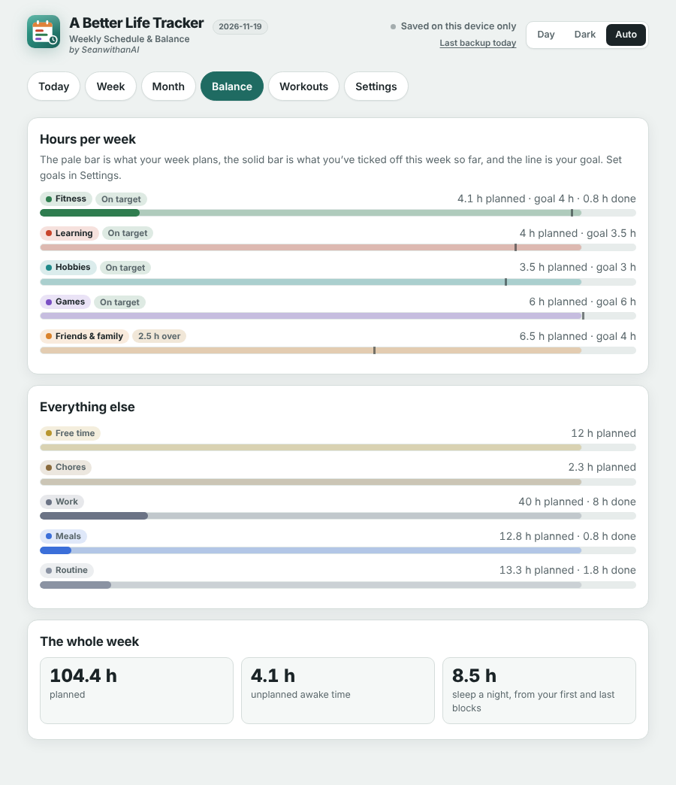
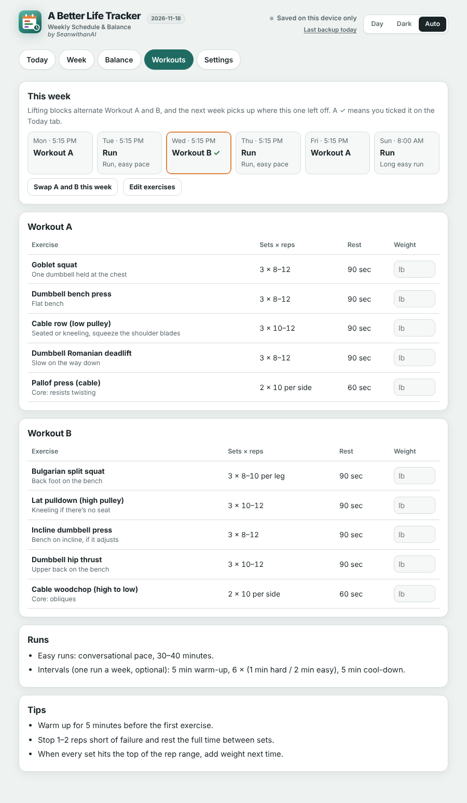

# A Better Life Tracker

**Weekly Schedule & Balance: plan your week in time blocks, tick them off each day, and see whether your hours match your goals**

**[▶ Open it online](https://seanwithanai.github.io/A-Better-Life-Tracker/)** · nothing to install · your data stays on your device

*by SeanwithanAI*

---

## Overview

A Better Life Tracker is a weekly planner for everything you're trying to fit in: work, workouts, study, hobbies, friends, dates, chores and sleep. You build one typical week out of time blocks, tick them off as you go, and the Balance tab shows whether the hours you've planned (and actually done) match the goals you set. Chores come in from your calendar, so the ones due each day show up next to your plan. It's all in one HTML file, with nothing to install and no sign-up.

## Features

- **Today at a glance.** What you should be doing right now, how long is left and what's next, plus today's whole plan with a check box for each block and today's chores.
- **Your week in time blocks.** Pick a day and tap any block to change its time, name, category or note. Add a block to several days at once, or copy a whole day onto others. Overlapping blocks are flagged.
- **Month at a glance.** A calendar for any month: each day shows its plan as a colored bar, its workouts (Lift A, Lift B, Run) and the chores due, and past days show how many activities you ticked off. Tap a day to see its whole plan and chores, and tick them off from there. On a phone, workouts and chores show as dots.
- **Categories and weekly goals.** Color-coded categories (Fitness, Learning, Hobbies, Games, Friends & family, Chores and more), each with an optional goal in hours a week. Rename them, recolor them and add your own.
- **Balance.** For each category: hours planned, hours ticked off this week, and your goal, with *On target*, *short* or *over* at a glance. It also shows your total planned time, unplanned awake time and roughly how much sleep your schedule leaves.
- **Workouts.** Lifting blocks alternate **Workout A** and **Workout B**, and each week picks up where the last one left off. Each workout has its own exercises, sets, reps, rest and a place to note the weight you use. Edit the exercises, run notes and tips to fit your own gym.
- **Chores.** Add chores yourself with **+ Add chore** (in Settings or on the Week tab): a name, date, optional time and length, and how often it repeats: daily, every few weeks on chosen days, monthly on a date or on a weekday like the 3rd Tuesday or the last Friday, or yearly, with an optional end date. Tap any chore to change or delete it.
- **Chores from your calendar.** Import an `.ics` file from Apple Calendar, Google Calendar, Fastmail, Thunderbird or any other calendar app. Repeating chores show up on the right days, whether they repeat every 2 weeks, every 12 weeks, on the 3rd Tuesday or once every few years. Moved and skipped dates are respected, and chores that have already ended are left out. Import the same calendar again to update it.
- **Send your week to a calendar.** Download your week as an `.ics` file with every block repeating weekly, to add to any calendar app (optionally leaving out work, meals and routine).
- **A sample week to start from**, built around a Monday–Friday job, or an empty week to fill in yourself.
- **12- or 24-hour clock**, and Day, Dark and Auto themes.
- **Backups.** One-tap backup and restore, a reminder every 7 days when your data is only on one device, and **Download app + data (.zip)** to keep this version of the app with your data.
- **PageVault ready.** Opened from [PageVault](https://github.com/SeanwithanAI/PageVault), everything is saved on your own server, separately for each person.

## Screenshots

| Your week | Month |
|---|---|
|  |  |

| Balance | Workouts |
|---|---|
|  |  |

## Getting started

1. Open the **[web link](https://seanwithanai.github.io/A-Better-Life-Tracker/)**, or open `A-Better-Life-Tracker-<date>.html` in any modern browser, or open it from **PageVault**.
2. Choose **Start with the sample week** or **Start with an empty week**.
3. On the **Week** tab, change the blocks to match your life. Set a block's type to **Lifting** or **Run** to have it show on the Workouts tab.
4. In **Settings**, give the categories you care about a goal in hours a week, and add your chores (type them in, or import a calendar file).
5. Each day, tick blocks off on the **Today** tab, and check the **Balance** tab once a week.

**Getting an .ics file:** in Google Calendar, go to **Settings → Import & export → Export**. In Apple Calendar on a Mac, select the calendar and use **File → Export → Export…**. In Fastmail, go to **Settings → Calendars**, pick the calendar and choose **Export**.

## Opening the file on your devices

**Easiest: the web link.** Open **[seanwithanai.github.io/A-Better-Life-Tracker](https://seanwithanai.github.io/A-Better-Life-Tracker/)** on any phone, tablet or computer. It's this same app, served by GitHub, and it always has the newest version. Nothing is sent anywhere: your data is saved in that browser on that device, just like the downloaded file. On iPhone or iPad, open it in Safari, tap **Share** (on iOS 26 and later, tap **•••** first), then **Add to Home Screen** to keep it like an app. On Android, use Chrome's **⋮ → Add to Home screen**.

Prefer to keep your own copy of the file? The app is one self-contained `.html` file: open it in the file list above, then use the **Download raw file** button (↓) at the top right of the file view.

**Desktop (Windows, macOS, Linux)**
1. Download the file and move it somewhere permanent, like Documents.
2. Double-click it. It opens in your default browser (Chrome, Edge, Firefox, Safari and Brave all work).
3. Bookmark it, and always open it the same way: same file, same place, same browser. Your data is saved in that browser for that file, so a copy in another folder or another browser starts empty.

**iPhone and iPad**
**Because of iOS, an HTML file saved on your iPhone or iPad can't be opened in Safari.** Use the web link above, or open the app's PageVault link in Safari and add it to your Home Screen.

**Android**
1. Download the file in Chrome.
2. Open it from Chrome: **⋮ → Downloads** and tap the file.
3. Turn on backups (the app reminds you every 7 days), or use **PageVault** so your data lives on your server instead.

**Moving to another device:** download a backup in the app, open the app on the new device, and restore the backup there. With PageVault there's nothing to move.

## Where your data is stored

| Opened from… | Saved to | Status shown under the app's name |
|---|---|---|
| **PageVault** | Your own server only, separately for each signed-in person. Nothing is kept in the browser. No backup reminders. | *Saved to your server* |
| **A local file or the web link** | This browser only. Use **Settings → Download backup** to keep a copy; a reminder appears after 7 days without one. | *Saved on this device only* |

Moving between the two: back up on one side and **Restore from backup** on the other.

## Versioning

Only the newest release is kept in the repo: `A-Better-Life-Tracker-2026-11-19-mk2.html`. Each new release replaces it, and `docs/index.html` (what the web link opens) is updated to match. Your data isn't stored in the file, so moving to a new release keeps it.

Releases are named with their date. The first release of a day is just the date; later releases that same day add `mk1`, `mk2`, `mk3`… (the count starts over each day). The version is also shown inside the app.

### Changelog

Every release so far, newest first. Older releases are listed for reference; only the current one is available to download.

| Version | Notes |
|---|---|
| **2026-11-19 mk2** | Fixes restoring a backup over existing data on phones, which could freeze or crash the browser on iPhone. Every question and notice (restore, delete, replace, erase) now opens in the app's own panel instead of the browser's pop-up, and a backup that can't be read leaves your current data untouched. |
| **2026-11-19 mk1** | **Add chores yourself**, without a calendar file: **+ Add chore** in Settings and on the Week tab. Set a date, optional time and length, and a repeat (daily; every few weeks on chosen days; monthly on a date, the 3rd Tuesday or the last Friday; yearly) with an optional end date. Tap any chore in Settings to change or delete it, including imported ones. |
| **2026-11-19** | **Month** tab: a calendar of any month showing each day's plan, workouts and chores due, with how much you ticked off on past days. Tap a day for its full plan and chores. |
| **2026-11-18** | First release. Today, Week, Balance, Workouts and Settings tabs; categories with weekly goals; an A/B lifting rotation; chores imported from a calendar file (`.ics`); your week exported as a calendar file; backups, the app + data zip, and PageVault support. |
